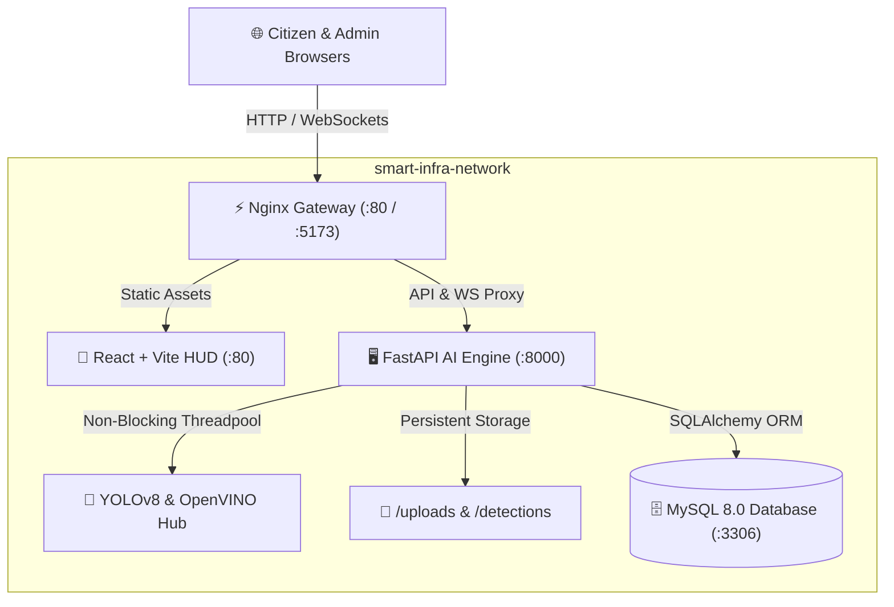

# 📡 Smart-Infra: AI Infrastructure Monitoring System

[](https://www.docker.com/)
[](backend/tests/)
[](https://fastapi.tiangolo.com/)
[](https://www.python.org/)
[](https://react.dev/)
[](https://github.com/ultralytics/ultralytics)
[](https://www.mysql.com/)

> [!IMPORTANT]
> **Next-Generation Urban Surveillance & Infrastructure Governance**: Smart-Infra is an enterprise-grade, AI-driven platform for automated road hazard detection, geospatial tracking, public reporting, and municipal work-order dispatch. It fuses custom-trained YOLOv8 with Intel OpenVINO optimization for high-frame-rate real-time inference on edge and server hardware.

---

## 📑 Table of Contents
- [✨ Key Features](#-key-features)
- [🛠️ Technology Stack](#️-technology-stack)
- [🏛️ System Architecture](#️-system-architecture)
- [🚀 Quick Start (Docker - Recommended)](#-quick-start-docker---recommended)
- [🧪 Automated Testing Suite](#-automated-testing-suite)
- [💻 Manual Local Development](#-manual-local-development)
- [🔐 Authentication & Access Control](#-authentication--access-control)
- [⚙️ Environment Variables & Configuration](#️-environment-variables--configuration)
- [📊 Model Performance & Benchmarks](#-model-performance--benchmarks)
- [⚡ Performance & Non-Blocking Architecture](#-performance--non-blocking-architecture)
- [📁 Repository Structure](#-repository-structure)
- [🛡️ Security & Privacy Architecture](#️-security--privacy-architecture)

---

## ✨ Key Features

- 🎯 **Real-Time Pothole & Hazard Detection**: Custom-trained YOLOv8 model capable of sub-25ms inference with OpenVINO CPU acceleration.
- 🛡️ **AI Pre-Submission Triage Gatekeeper**: Real-time computer vision filter in the citizen reporting pipeline. Evaluates uploaded damage photos with YOLO to reject fake, prank, selfie, or indoor spam uploads before they reach the database or municipal admins.
- 🗺️ **Geospatial Monitoring Map**: Interactive GIS mapping with severity-coded pins, live coordinate tracking, and hazard density heatmaps with lightweight projection queries.
- 📱 **Citizen Reporting & Tracking Portal**: Public interface for citizens to upload damage photos, geotag incidents, receive neural classification badges with confidence scores, and track maintenance progress in real time.
- 👷 **Municipal Admin Console & Work Orders**: Role-based officer portal to triage reports, dispatch field workers, assign tasks, log repair notes, and resolve work orders.
- 🤖 **Urban AI Advisor**: LLM-powered municipal copilot delivering maintenance prioritization, budget estimation, and repair strategy suggestions.
- 📡 **Live Telemetry & WebSocket Streams**: Low-latency bi-directional WebSocket feed broadcasting detection events, live FPS, and road integrity scores directly to the HUD with automatic dead-connection pruning.
- 🔒 **Automated Privacy Redaction**: Dynamic Gaussian blurring on bounding boxes containing people or vehicles to ensure citizen privacy compliance.

---

## 🛠️ Technology Stack

| Domain | Technologies |
| :--- | :--- |
| **AI & Computer Vision** | YOLOv8 (Ultralytics), OpenVINO (Intel CPU Optimized), OpenCV, SciPy (Centroid Tracker), PyTorch |
| **Backend Services** | Python 3.10+, FastAPI, SQLAlchemy ORM, PyMySQL, Pydantic v2, Uvicorn, WebSockets, Starlette Threadpools |
| **Database** | MySQL 8.0 (Docker) / SQLite (Fallback) with automatic schema migration |
| **Frontend HUD** | React 18, Vite, TypeScript, Lucide Icons, Leaflet / GIS Maps, Chart.js / Recharts |
| **Proxy & Gateway** | Nginx Alpine (Reverse Proxy, API Gateway, WebSocket Upgrade) |
| **Containerization** | Docker Engine & Docker Compose (Multi-Stage Builds, CPU-Wheel PyTorch Optimization) |
| **Testing** | Pytest, HTTPX, FastAPI TestClient (In-memory SQLite isolation) |

---

## 🏛️ System Architecture



---

## 🚀 Quick Start (Docker - Recommended)

The entire full-stack system—including MySQL 8, the FastAPI AI backend with CPU PyTorch, and the React frontend served by Nginx—launches with a single command or one-click launcher.

### Option A: One-Click Windows Launchers
- **Start All Services**: Double-click [`scripts/start_docker.bat`](file:///c:/Users/mdadi/OneDrive/Desktop/Smart-Infra/scripts/start_docker.bat) *(automatically starts Docker Desktop in the background and runs containers)*.
- **Stop All Services**: Double-click [`scripts/stop_docker.bat`](file:///c:/Users/mdadi/OneDrive/Desktop/Smart-Infra/scripts/stop_docker.bat).

### Option B: Terminal Command
```powershell
docker-compose up --build -d
```

### Accessing Services
- 🖥️ **Command Center & HUD (Frontend):** [http://localhost](http://localhost) (or [http://localhost:5173](http://localhost:5173))
- 📡 **Interactive API Docs (Swagger):** [http://localhost:8000/docs](http://localhost:8000/docs)
- 🗄️ **MySQL Database:** `localhost:3306` (Database: `smart_infra`, User: `root`)

### Inspecting Logs & Managing Containers
```powershell
# View streaming logs across all containers
docker-compose logs -f

# Check health and status of services
docker-compose ps

# Stop all services gracefully
docker-compose down
```

---

## 🧪 Automated Testing Suite

Smart-Infra features a regression test suite covering authentication, RBAC, database CRUD operations, AI inference, and pre-submission triage gates on an isolated in-memory test database.

### Running Backend Tests
```powershell
backend\venv\Scripts\pytest.exe backend/tests/ -v
```

### Test Coverage Highlights
- ✅ **Authentication**: Valid login, invalid credentials, non-existent user handling, token issuance, and `/auth/me` identity extraction.
- ✅ **Role-Based Access Control**: Verifies citizen restriction on `/admin/stats` (403 Forbidden) and administrative authorization (200 OK).
- ✅ **AI Gatekeeper (Fake Report Rejection)**: Verifies that blank, non-hazard, or fake photos are rejected with HTTP 400 and purged from disk.
- ✅ **AI Gatekeeper (Real Pothole Acceptance)**: Verifies that genuine asphalt damage is accepted, classified, and tagged with severity.
- ✅ **Multi-Tenant Isolation**: Ensures citizens only see their own reports while administrators access city-wide dispatches.
- ✅ **Privacy Redaction**: Confirms Gaussian blurring is applied to sensitive objects (people, vehicles) and omitted on road defects.

---

## 💻 Manual Local Development

If you prefer running services directly on your host machine without Docker:

### 1. Prerequisites
- Python 3.10 or 3.11
- Node.js 18+ and npm
- Local MySQL server (or automatic SQLite fallback)

### 2. Backend Setup
```powershell
cd backend
python -m venv venv
.\venv\Scripts\activate

# Install dependencies (CPU PyTorch + standard requirements)
pip install torch torchvision --index-url https://download.pytorch.org/whl/cpu
pip install -r requirements.txt

# Start FastAPI server
uvicorn main:app --reload --host 0.0.0.0 --port 8000
```

### 3. Frontend Setup
```powershell
cd frontend
npm install
npm run dev
```
The local Vite development server will be available at `http://localhost:5173` (or `http://localhost:3000` via `scripts/start_silent.bat`).

---

## 🔐 Authentication & Access Control

Access control and administrative privileges are enforced through secure role-based tokens:

- **Administrative Signup:** Admin registration requires a private verification code configured in your local environment (`ADMIN_SIGNUP_CODE`).
- **Initial Setup:** The deployment administrator defines this code privately before deployment. It is **never** committed to version control.
- **Account Creation:** Users and officers register their own distinct credentials through the application interface during first-time setup.

---

## ⚙️ Environment Variables & Configuration

All secrets and system configurations are kept strictly confidential in `backend/.env` (which is excluded from Git via `.gitignore`). 

To configure your local environment, copy the template:
```powershell
cp backend/.env.example backend/.env
```

| Variable | Description | Required | Recommended Format / Default |
| :--- | :--- | :---: | :--- |
| `DATABASE_URL` | SQLAlchemy connection URI | **Yes** | `mysql+pymysql://<user>:<password>@localhost:3306/smart_infra` |
| `JWT_SECRET` | Secret key for cryptographic JWT signing | **Yes** | Generate with: `openssl rand -hex 32` |
| `ADMIN_SIGNUP_CODE` | Private passphrase required for Admin registration | **Yes** | Long, high-entropy custom secret passphrase |
| `ADMIN_INVITE_TTL_HOURS` | Lifetime for admin invitation tokens (hours) | No | `24` |
| `DETECTION_THRESHOLD` | Confidence threshold for YOLO detection | No | `0.45` (Range: `0.10` - `1.00`) |
| `AI_PROVIDER` | LLM backend for Urban Advisor | No | `GEMINI` or `BYTEZ` |
| `AI_API_KEY` | LLM API Key (stored privately in local `.env`) | Optional | Set locally when using generative AI features |

---

## 📊 Model Performance & Benchmarks

The core YOLOv8 model was custom-trained and evaluated on municipal asphalt damage datasets:

| Metric | Score | Note |
| :--- | :--- | :--- |
| **mAP@50** | `66.50%` | Mean Average Precision at IoU 0.50 |
| **Precision** | `65.92%` | Low false-positive rate on street markings |
| **Recall** | `62.15%` | Robust detection under shadowed conditions |
| **F1-Score** | `~64.00%` | Harmonic balance between precision & recall |
| **Inference Latency** | `~18-28 ms` | OpenVINO CPU mode on Intel Core i5/i7 |

---

## ⚡ Performance & Non-Blocking Architecture

1. **Non-Blocking Inference**: All synchronous CPU-bound YOLO predictions and image decodes run via Starlette's `run_in_threadpool`. This prevents the main asyncio event loop from blocking, ensuring live WebSockets and HTTP requests maintain sub-10ms response times during inference.
2. **WebSocket Auto-Pruning**: Severed client connections are detected and batch-pruned during broadcasts, preventing memory leaks.
3. **Optimized Query Projections**: `/map-data` extracts coordinates using lightweight scalar projections (`Detection.id, latitude, longitude, confidence, object_type, created_at`) instead of instantiating 1,000 full ORM entities.
4. **Single-Pass Aggregations**: `/admin/stats` aggregates counts using SQL `CASE WHEN` statements, eliminating multiple sequential table scans.
5. **View-Aware Polling**: The frontend dashboard polls map data only when the Map tab is actively rendered, saving client CPU, network bandwidth, and database connections.

---

## 📁 Repository Structure

```
Smart-Infra/
├── docker-compose.yml          # Multi-container orchestration (DB, API, Web)
├── .dockerignore               # Container build exclusions
├── .gitignore                  # Git exclusions for models, logs, and caches
├── README.md                   # System documentation and setup guide
│
├── backend/                    # Python FastAPI AI Brain
│   ├── ai/                     # YOLOv8 models (.pt, .xml), tracker, and logic
│   ├── detections/             # Saved detection frames and snapshots
│   ├── logs/                   # System and inference logs
│   ├── uploads/                # Citizen-uploaded damage photos
│   ├── tests/                  # Automated pytest test suite (14 passing tests)
│   │   ├── conftest.py         # In-memory test fixtures & client setup
│   │   ├── test_auth_api.py    # Authentication & RBAC tests
│   │   ├── test_database_crud.py # Detections & work order tests
│   │   ├── test_reports_triage.py # Fake report rejection & triage tests
│   │   └── test_ai_inference.py # YOLO loading & privacy blurring tests
│   ├── database.py             # SQLAlchemy models and connection retry logic
│   ├── main.py                 # REST API endpoints, AI triage, and WebSocket handlers
│   ├── models.py               # 8 SQLAlchemy relational data models
│   ├── requirements.txt        # Backend Python dependencies
│   └── Dockerfile              # CPU-optimized multi-stage Docker build
│
├── frontend/                   # React + TypeScript Command Center
│   ├── src/
│   │   ├── api/                # API client configuration and endpoints
│   │   ├── components/         # HUD widgets, Map, Admin Console, Advisor
│   │   ├── pages/              # Dashboard, Report Issue, Admin, Login
│   │   └── App.tsx             # Root router and authentication guards
│   ├── nginx.conf              # Production reverse proxy configuration
│   ├── package.json            # Optimized frontend dependencies
│   └── Dockerfile              # Multi-stage Vite build served via Nginx
│
└── scripts/                    # Automation scripts
    ├── start_docker.bat        # 1-click background Docker Desktop launcher
    ├── stop_docker.bat         # 1-click Docker container shutdown
    ├── start_silent.bat        # Local dev background launcher (no Docker)
    └── stop_servers.bat        # Local dev process shutdown
```

---

## 🛡️ Security & Privacy Architecture

Smart-Infra implements defense-in-depth protection across all layers:

- **Zero-Secrets Policy:** Real credentials, database passwords, JWT signing keys, and admin signup codes are **never** committed to version control.
- **Local Environment Isolation:** All production secrets reside exclusively in local `backend/.env` files, strictly ignored via `.gitignore`.
- **Anti-Brute Force Protection:** Authentication endpoints (`/auth/login` and `/auth/register`) enforce dynamic IP/email rate-limiting with automated lockouts and audit logging.
- **Secure File Upload Pipeline:** Image uploads in citizen reporting feature cryptographic UUID file renaming, strict extension/MIME-type whitelisting (`.jpg`, `.jpeg`, `.png`, `.webp`), and streaming size enforcement (max 10MB) to eliminate Path Traversal and Remote Code Execution (RCE).
- **AI-Powered Triage Filtering:** Prank, blank, or non-infrastructure images submitted through citizen reporting are rejected and purged before database commit.
- **Admin Verification Gate:** Self-service administrative registration requires a locally verified `ADMIN_SIGNUP_CODE` with placeholder blacklist rejection, or single-use invitation tokens with a 24-hour expiration window.
- **Protected Hardware & Process Feeds:** Camera activation (`/start-camera`, `/stop-camera`) is strictly guarded behind user session authentication and input sanitization to eliminate command injection.
- **HTTP Defense Headers:** Standard security headers (`X-Content-Type-Options: nosniff`, `X-Frame-Options: DENY`, `Referrer-Policy`) protect client sessions from clickjacking, MIME sniffing, and cross-site leaks.

---

*Built with ❤️ for Smarter, Safer Municipal Infrastructure.*
